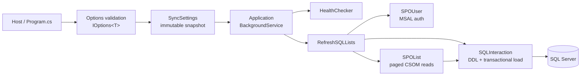

# SPO2SQL

[](https://github.com/kill74/SPO2SQL/actions/workflows/ci.yml)
[](https://github.com/kill74/SPO2SQL/actions/workflows/codeql.yml)
[](https://dotnet.microsoft.com/)
[](LICENSE)

**SPO2SQL** is a .NET 8 console service that replicates SharePoint Online list data into SQL Server tables. It is built for unattended, scheduled execution: configuration is validated at startup, I/O is asynchronous and cancellation-aware, and failures are reflected in the process exit code.

---

## Capabilities

- **Full and incremental sync** — a persisted UTC watermark drives `Modified >= lastSync` queries on subsequent runs.
- **Safe schema evolution** — destination tables are created on first run and extended additively when new source columns appear; no destructive DDL.
- **Explicit mappings** — per-list and per-column rules for inclusion, exclusion, destination names and SQL types, sourced from a legacy XML file.
- **Resilience** — transient SharePoint/network failures are retried with exponential backoff and jitter; a cancelled run rolls back cleanly.
- **Transactional bulk writes** — SharePoint data is read and transformed before a SQL transaction is opened; rows are then loaded with `SqlBulkCopy` in configurable batches, so no locks are held during network calls and the number of SQL round trips is constant.
- **Bounded parallelism** — independent lists are synchronized concurrently with `Application:MaxParallelLists` (default 4); failures in one list do not stop the others.
- **App-only authentication** — certificate-based client credentials work under MFA and Conditional Access; username/password remains a legacy fallback.
- **Startup health checks** — authenticated SharePoint connectivity and a real SQL connection are verified before any sync starts.
- **Observability** — structured logging plus OpenTelemetry metrics (`spo2sql.lists.synced`, `spo2sql.items.*`, `spo2sql.sync.duration`) tagged by list and sync mode.

---

## Architecture



The console host owns configuration, dependency injection, logging and exit-status policy. `SPO2SQL.Core` owns all SharePoint, SQL, credential and mapping logic and receives a single `SyncSettings` record — it never reads global configuration itself.

### Repository layout

```text
src/
  SPO2SQL.Console/             Host, options, startup, health checks, CLI setup
  SPO2SQL.Core/
    Configuration/             SyncSettings passed through the sync pipeline
    Security/                  Credential provider chain (env, DPAPI, configured values)
    SharePoint/                Auth, paged list access, retry, CAML, health checks, DQ
    SqlServer/                 Table management and transactional data transfer
    XmlConfig/                 Legacy list/column mapping reader
tests/
  SPO2SQL.Core.Tests/          Core unit tests
  SPO2SQL.Console.Tests/       Options, validation and exit-code tests
docs/                          Configuration, security and modernization notes
SPOtoSQL-Snapshots/            Historical .NET Framework source (reference only)
```

### Key dependencies

| Concern | Library |
| --- | --- |
| SharePoint access | `Microsoft.SharePointOnline.CSOM` |
| Authentication | `Microsoft.Identity.Client` (MSAL) |
| SQL access | `Microsoft.Data.SqlClient` |
| Hosting / options / logging | `Microsoft.Extensions.*` 9.0 (targets `net8.0`) |
| Windows credential store | `System.Security.Cryptography.ProtectedData` |
| Testing | xUnit, FluentAssertions, NSubstitute, coverlet |

---

## Getting started

### Prerequisites

- .NET SDK 8.0 (the repository pins the 8.0 SDK band via `global.json`)
- Network access to the target SharePoint Online site
- SQL Server access with `CREATE TABLE` / `ALTER` rights on the destination database
- An app registration with SharePoint application permissions (recommended), or a legacy user account

### Build and test

```bash
dotnet restore SPO2SQL.sln
dotnet build SPO2SQL.sln --no-restore -warnaserror
dotnet test SPO2SQL.sln --no-build --no-restore
dotnet format SPO2SQL.sln --verify-no-changes --no-restore
```

Warnings are treated as errors and nullable reference types are enforced without blanket suppressions.

### Run

```bash
dotnet run --project src/SPO2SQL.Console/SPO2SQL.Console.csproj
```

`Application:DailyMode` selects the mode: `true` for incremental sync, `false` for a full current-time transfer. The process returns `0` on success and `1` on validation, health-check or synchronization failure.

---

## Configuration

Configuration is resolved in this order (later sources win):

1. `appsettings.json`
2. `appsettings.{Environment}.json`
3. .NET user secrets
4. Environment variables
5. Environment variables prefixed with `SPO2SQL_`
6. Command-line arguments

Example:

```json
{
  "Application": {
    "Name": "SPO2SQL",
    "Version": "2.0.0",
    "LogLevel": "Information",
    "EnableHealthChecks": true,
    "EnableMetrics": true,
    "DailyMode": true,
    "MaxParallelLists": 4,
    "LegacyConfigPath": "XmlConfig/UserConfig.xml"
  },
  "SharePoint": {
    "SiteUrl": "https://contoso.sharepoint.com/sites/example",
    "Username": "",
    "Password": "",
    "TimeoutSeconds": 120,
    "MaxRetries": 3,
    "InitialRetryDelayMs": 1000,
    "TenantId": "00000000-0000-0000-0000-000000000000",
    "ClientId": "00000000-0000-0000-0000-000000000000",
    "CertificatePath": "/secure/spo2sql.pfx",
    "CertificatePassword": ""
  },
  "Sql": {
    "ConnectionString": "Server=sql01;Database=SPO2SQL;Encrypt=true;TrustServerCertificate=false;Integrated Security=true;",
    "CommandTimeoutSeconds": 300,
    "BatchSize": 80,
    "EnforceEncryption": true
  }
}
```

`Sql:BatchSize` controls both the SharePoint page size and the number of rows sent per SQL bulk-copy batch. `Application:EnableMetrics` publishes the `SPO2SQL` OpenTelemetry meter; without `OTEL_EXPORTER_OTLP_ENDPOINT` metrics are written to the console.

Supply secrets outside source control. For local development:

```bash
dotnet user-secrets set "Sql:ConnectionString" "Server=...;Encrypt=true;" --project src/SPO2SQL.Console
```

For scheduled jobs:

```bash
export SPO2SQL_SharePoint__TenantId="..."
export SPO2SQL_SharePoint__ClientId="..."
export SPO2SQL_SharePoint__CertificatePath="/secure/spo2sql.pfx"
export SPO2SQL_Sql__ConnectionString="Server=...;Encrypt=true;TrustServerCertificate=false;"
```

On Windows, `dotnet run --project src/SPO2SQL.Console -- --setup-secrets` stores username, password and connection string in the current user's DPAPI-protected store. The legacy environment names `SPO_USERNAME`, `SPO_PASSWORD` and `SQL_CONNECTION_STRING` are also honoured by the credential provider chain.

### List mappings

List and column mappings still come from the XML file referenced by `Application:LegacyConfigPath`. It defines which lists are processed, their site-relative paths, destination names and column rules. The file must exist at runtime; a missing file causes an explicit configuration error. Keep deployment-specific XML outside source control when it contains infrastructure details. See [`docs/Configuration/README.md`](docs/Configuration/README.md).

---

## Authentication

| Mode | When to use | Configuration |
| --- | --- | --- |
| **App-only (recommended)** | Unattended jobs, MFA/Conditional Access tenants | `TenantId`, `ClientId`, `CertificatePath` (and optionally `CertificatePassword`) |
| Username/password (ROPC) | Legacy tenants only; blocked by MFA | `Username`, `Password` |

At least one complete mode must be configured — startup validation fails otherwise. The app-only scope is `{scheme}://{host}/.default` for the configured site. Tokens are cached per site and renewed before expiry; token acquisition is serialized to avoid races across concurrent requests.

SQL encryption is enforced by default: `Encrypt=true` and `TrustServerCertificate=false` are required unless `Sql:EnforceEncryption` is explicitly disabled.

---

## Synchronization behaviour

- Lists are read with explicit paging (`BatchSize` items per page), so large lists are not truncated.
- On the first run all items are read; the UTC watermark captured before the read is persisted afterwards. Items modified during a run are therefore picked up by the next incremental run.
- Failures in individual inserts are aggregated; the transaction is rolled back rather than leaving a partially loaded snapshot.
- Only additive columns are created on existing tables. Existing columns, data types and rows are never altered or removed by the tool.
- The process stops application startup if health checks report unreachable SharePoint or SQL endpoints.

### Known limitations

- The list-specific data-quality routines in `SPO2SQL.Core/SharePoint` are implemented but are **not yet invoked** by the default orchestration.
- Metrics are exported to the console by default; set `OTEL_EXPORTER_OTLP_ENDPOINT` to switch to an OTLP collector.
- Integration tests against a live tenant and SQL Server are not part of the automated suite.

---

## CI/CD

GitHub Actions runs on pushes to `main`/`master`/`develop` and on pull requests, on both Ubuntu and Windows:

1. Restore (with NuGet audit enabled)
2. Build with warnings as errors
3. Formatting verification
4. Unit tests with coverage upload
5. NuGet vulnerability audit

CodeQL analysis is configured separately. GitLab CI mirrors the build, test, format and audit stages.

---

## Security

- Never commit credentials, certificates or connection strings.
- Prefer app-only authentication and least-privilege SQL identities.
- Keep `EnforceEncryption` enabled outside isolated development environments.
- `SharePoint:SiteUrl` must use HTTPS; startup validation rejects plain HTTP.
- The Windows credential store file is ACL-restricted to the current user in addition to being DPAPI-encrypted.
- Legacy username/password authentication emits an explicit startup warning.
- Environment-backed secrets survive credential rotation without redeploying binaries.
- Stack traces are logged through the structured logger, not written ad-hoc to stdout.

See [`docs/SECURITY.md`](docs/SECURITY.md) for the full guidance.

---

## Development

Work on feature branches; `master` receives changes through reviewed pull requests. Keep the local validation loop green before opening a PR:

```bash
dotnet build SPO2SQL.sln -warnaserror
dotnet test SPO2SQL.sln
dotnet format SPO2SQL.sln --verify-no-changes
```

---

## License

MIT.
